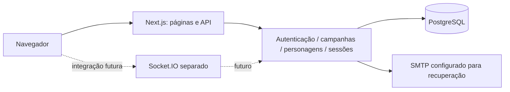

# Arquitetura

## Implementação atual

Monorepo de diretórios com manifesto e lockfile únicos. Next.js App Router/React entrega páginas públicas e autenticadas, componentes cliente para formulários e route handlers REST. TypeScript strict/noUncheckedIndexedAccess, Tailwind e Lucide. PostgreSQL 17, Prisma 7 com adaptador pg. Socket.IO fica em processo separado e ainda recusa handshakes de jogo.

`packages/contracts` valida entradas Zod; `packages/domain` recebe conexão Prisma, valida identidade, associação e ação, executa transações e auditoria. `server/core` configura serviços e `server/http` trata cookies, origem, corpo limitado e erros. Componentes nunca decidem autorização final. Leituras autenticadas não são cacheadas.

Autenticação: Argon2id, sessões opacas aleatórias de sete dias, só hash do token persistido, cookie HttpOnly/SameSite Lax/Secure no HTTPS. Recuperação usa token de 30 minutos de uso único, SMTP real, revogação dos links anteriores e de todas as sessões ao redefinir. Rate limit atômico no PostgreSQL; não confiar em cabeçalhos de IP fornecidos pelo cliente.

Campanhas têm papel por associação, convites limitados/revogáveis/expiráveis, arquivamento e auditoria. Operações de campanha serializam decisões críticas por lock transacional da campanha, incluindo convites, fichas e sala. É simples e consistente, mas deverá ser medido sob carga antes de aumentar concorrência.

Fichas usam linhas de atributos normalizadas, cálculos independentes em `packages/rules`, versão esperada e histórico transacional. Mestre pode alterar todos os campos e responsável membro; jogador apenas próprios, se habilitado. Classe/espécie e progressão ainda são manuais. A migração preserva fichas anteriores com campos textuais vazios, apresentados como não informados.

Sessões compartilhadas são salas de preparação persistidas. Participantes referenciam membro e personagem da mesma campanha com FKs compostas. Não representam presença online. Leituras atualizam ao recarregar; atualizações em tempo real, mapas e tokens não foram implementados.

## Evolução planejada

Socket.IO deverá reutilizar autorização e serviços, persistir antes de emitir, filtrar segredos por destinatário, recuperar snapshots e tratar versões/conflitos. Outbox/Redis serão avaliados para múltiplas instâncias. PixiJS será carregado no cliente da mesa; WebGL não deve executar no SSR. Efeitos independentes e Three.js futuro.

Arquivos local/S3 ainda não implementados: exigirão validação binária, limite, chaves não previsíveis e download autorizado. Magias, inventário e habilidades serão módulos/entidades próprios ligados à ficha, sem substituir persistência por JSON único.

## Qualidade e operação

Formulários acessíveis, foco, navegação móvel, preferências visuais e redução de movimento; sem fontes remotas no build. Testes reais de PostgreSQL separados em ct_rpg_test e E2E em build de produção. Lançador carrega dotenv sem flags herdadas incompatíveis com processos internos do Next no Windows.

Deploy futuro separará web/realtime, TLS/proxy WebSocket, banco e objetos privados, logs sem tokens, monitoramento e backups/PITR. RPO/RTO e recuperação ainda precisam ser definidos e demonstrados.

## Catálogo e fluxo contextual

`packages/catalog` contém dados versionados e fonte/licença; `packages/domain/character-options` valida a escolha e sua disponibilidade. Componentes CatalogChoice e CharacterEditor guiam criação/revisão, mantendo o modo manual. A navegação da campanha é comum às páginas filhas e verifica acesso no servidor. Consultas gerais filtram proprietário; consulta elegível filtra campanha e autorização. Não há alteração das associações existentes. Consulte CATALOGO_SRD.md para escopo e limitações.
