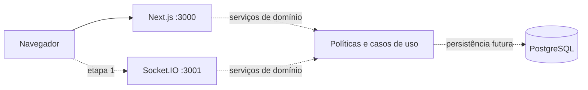

# Arquitetura

## Estado implementado

Monorepo de diretórios com um manifesto npm e lockfile: reduz configuração inicial, mantém módulos separados e tipos compartilhados. Next.js App Router entrega páginas públicas estáticas e endpoint de saúde. Serviço Socket.IO dedicado mantém seu próprio ciclo de vida Node. PostgreSQL 17 com Prisma 7; driver pg via PrismaPg. TypeScript strict e noUncheckedIndexedAccess.

Linhas pontilhadas são integrações futuras. As páginas atuais não acessam o banco; a fábrica de cliente está preparada. Realtime recusa todos os handshakes de aplicação. Nenhum endpoint CRUD está exposto.

## Arquitetura alvo

Route handlers REST delegam a serviços de domínio; Socket.IO usa os mesmos serviços e autorização. Não duplicar regras de persistência em eventos. Transações gravam dados e histórico antes de notificar. Eventos terão versão e identificador idempotente; reconexão recupera snapshot filtrado por participante. Outbox transacional e adaptador Redis serão avaliados antes de múltiplas instâncias.

Sessões opacas, tokens em hash no banco, cookies HttpOnly/Secure/SameSite e senhas com Argon2id. Identidade global separada do papel por campanha. Autenticação será desenvolvida ou integrada a solução mantida na etapa 1 após revisão específica. Nenhum algoritmo de senha é implementado nesta etapa.

PixiJS será carregado somente no cliente da mesa na etapa 1, sem acessar WebGL em SSR. Cena persistida normalizada em mapas/tokens, câmera local, regras independentes. Camadas de efeitos opcionais e Three.js futuro, sem dependência instalada antes de uso real.

Arquivos: interface de armazenamento local em desenvolvimento e S3 em produção, a implementar. Arquivos privados, chaves não previsíveis, download autorizado, limite de tamanho, validação de assinatura binária e metadados. PDFs apenas de modelos documentados.

## Qualidade e acessibilidade

HTML semântico, idioma pt-BR, foco visível, link para pular navegação, navegação móvel, preferências locais e prefers-reduced-motion. Não há fontes ou imagens remotas necessárias para o build. CSS cria paisagem original. Recursos futuros terão testes de autorização, integração PostgreSQL e E2E com dois usuários.

## Operação futura

Separar web e realtime no deploy; TLS e proxy para conexões persistentes. Banco e objetos privados. Logs estruturados sem tokens/senhas, métricas de latência, erros e reconexão. Backups PostgreSQL diários e PITR conforme hospedagem; cópias de objetos versionadas e exercício de restauração em ambiente isolado. Definir RPO/RTO antes da produção. Este plano ainda não é infraestrutura implantada.
